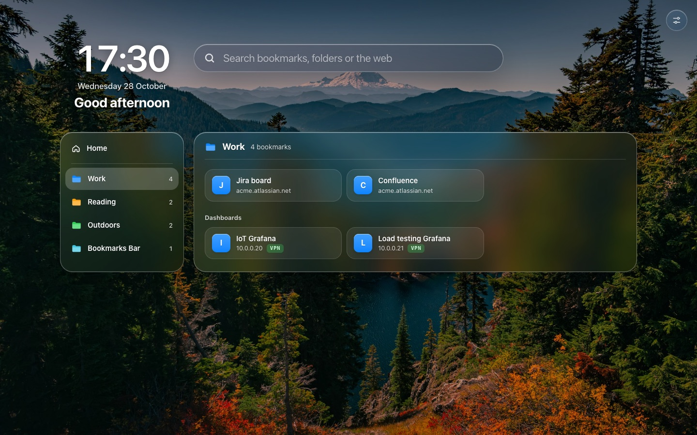

# Overlook

A new tab page for Chrome, Edge, Brave and other Chromium browsers: your bookmarks in folders, a Spotlight-style search, and sharp site icons over a photo of your choice.



## Features

- Your real browser bookmarks, with folders in a sidebar and subfolders as sections.
- Search by name, site, folder or label. It forgives typos ("grafna" finds Grafana), and the links you open most rise to the top.
- Home shows the bookmarks you pin, with your most-used links below them.
- High-resolution site icons, kept on your device so they still show when you're offline or off the VPN. A site without a good icon gets a coloured letter.
- Labels that tag bookmarks by address, such as VPN for sites that only open on the work network.
- Four bundled photos, an image of your own, or a [dynamic wallpaper](#dynamic-wallpaper-optional) that follows the sun.

## Install

You need Chrome or Edge 120 or newer, or another browser built on Chromium 120 or newer, such as a current Brave.

1. Download `overlook-v<version>.zip` from the [Releases](../../releases) page and unzip it. Move the `overlook` folder inside it somewhere permanent: the browser runs the extension from there.
2. Open `chrome://extensions`, `edge://extensions` or `brave://extensions`.
3. Turn on **Developer mode**, click **Load unpacked** and choose the `overlook` folder.
4. Open a new tab. If the browser asks whether to keep the new tab page Overlook set, keep it.

To update, replace the contents of your `overlook` folder with the new release, keeping its `wallpapers` folder if you added one, and click the reload button on Overlook's card. Your settings, favourites and icons stay. Don't remove Overlook and load it again: **Remove** deletes everything it kept.

To build it yourself instead, install Node.js 24 or newer, run `npm ci` and `npm run build`, and load the `dist` folder.

## Using Overlook

Start typing anywhere on the page to search. The last result searches the web with your default search engine. To pin a bookmark to Home, hover over it and click ☆. **Edit** on Home lets you reorder or unpin your favourites.

On Windows and Linux the shortcut key is `Ctrl`. On a Mac it's `⌘`.

| Key                                | What it does                                                                    |
| ---------------------------------- | ------------------------------------------------------------------------------- |
| Start typing, `/` or `Ctrl+K`      | Go to the search box                                                            |
| `↑` `↓`                            | Move through the results                                                        |
| `Enter`                            | Open the selected result                                                        |
| `Ctrl+Enter`                       | Open the selected bookmark in a background tab (or the web search in a new tab) |
| `Tab` on a folder                  | Search inside that folder                                                       |
| `Backspace` in an empty search box | Leave the folder you're searching in                                            |
| `Esc`                              | Clear the search, then leave the folder, then close the results                 |
| `,`                                | Open Settings                                                                   |

`Ctrl`-click or middle-click a bookmark to open it in a background tab.

Settings (the sliders button, top right) is where you pick the background, choose what Home shows, edit labels and download the site icons again.

Browsers put a new tab's cursor in the address bar. Overlook moves it to its search by switching the tab to one of its own pages and straight back, so the address may flash and the Forward arrow stays lit. You can turn this off under Home in Settings.

## Dynamic wallpaper (optional)

Overlook can show a set of pictures of one scene, picking the one that matches the sun where you are (worked out from your time zone, never your location) and fading to the next as the day goes on. You bring the pictures.

Put the pictures and a `manifest.json` in a folder named `wallpapers` inside the `overlook` folder (or in `public/wallpapers` before you build from source). Then reload Overlook on the extensions page.

```json
{
  "version": 1,
  "frames": ["dawn.jpg", "noon.jpg", "dusk.jpg", "night.jpg"],
  "mode": "solar",
  "schedule": [
    { "frame": 3, "altitude": -20, "azimuth": 30 },
    { "frame": 0, "altitude": 2, "azimuth": 95 },
    { "frame": 1, "altitude": 55, "azimuth": 170 },
    { "frame": 1, "altitude": 55, "azimuth": 190 },
    { "frame": 2, "altitude": 2, "azimuth": 265 },
    { "frame": 3, "altitude": -20, "azimuth": 330 }
  ]
}
```

- `frames` lists the picture files, which sit next to `manifest.json`. A name may use letters, digits, `_`, `-` and `.`, and must end in `.jpg`, `.jpeg`, `.png`, `.webp` or `.avif`.
- Each `schedule` entry points at a picture by its index in `frames`.
- In `"solar"` mode, an entry gives the sun's altitude and azimuth in degrees when its picture was taken. Overlook shows the picture whose altitude is closest to the sun's now. The azimuth only tells morning pictures (under 180) from evening ones, so a picture used both morning and evening, like noon or night above, needs one entry per side.
- In `"time"` mode, an entry has a `dayFraction` instead, from 0 (midnight) to 1, and its picture shows from that time of day until the next entry starts.

## Privacy and permissions

Overlook has no servers, no analytics and no third-party code.

- Your settings, labels, favourites and a score for each link you open stay in the browser's extension storage. Site icons and your uploaded image are kept in IndexedDB. Removing the extension deletes all of it.
- To find a site's icon, Overlook requests the site's home page, its web app manifest and a few icon files. Requests carry no cookies and no referrer, and each site is checked again only when its icon is due.
- Icons only come from the bookmarked site itself or from public hosts. A page that points its icon at your router or anything else on a private network is ignored.
- Web searches go to your default search engine, and only when you choose the "search the web" result.

| Permission                     | Why                                                                     |
| ------------------------------ | ----------------------------------------------------------------------- |
| `bookmarks`                    | Show and search your bookmarks                                          |
| `favicon`                      | Show the browser's own small icon while a sharp one downloads           |
| `search`                       | Send "search the web" to your default search engine                     |
| `storage`                      | Keep your settings and which links you open most                        |
| `https://*/*` and `http://*/*` | Download each bookmarked site's icon. Nothing is injected into any page |

## Troubleshooting

- **Icons are missing for VPN or intranet sites:** connect to the network, open Settings and press **Download icons again**.
- **A new tab still shows the browser's own page:** check that Overlook is turned on and that you kept its new tab page when the browser asked. Work or school browsers may block extensions loaded in developer mode.
- **A `file://` bookmark doesn't open:** open Overlook's **Details** on the extensions page and turn on **Allow access to file URLs**.
- **To uninstall:** click **Remove** on Overlook's card, then delete the `overlook` folder.

## Credits and licences

Overlook is under the [MIT License](LICENSE), except for the bundled photos. They come from Unsplash and are used under the [Unsplash License](https://unsplash.com/license): [Autumn forest](https://unsplash.com/photos/qG-zuuHbFTw) by Kush Dwivedi, [Still lake](https://unsplash.com/photos/R9-Hwv8nDl0) by Ahmet Yüksek, [Golden haze](https://unsplash.com/photos/wndpWTiDuT0) by Cristina Gottardi and [Alpine ridge](https://unsplash.com/photos/HXbAioPEVyQ) by Dario Jud. Time zone locations come from the [IANA tz database](https://www.iana.org/time-zones).

To report a security issue, see [SECURITY.md](.github/SECURITY.md).
