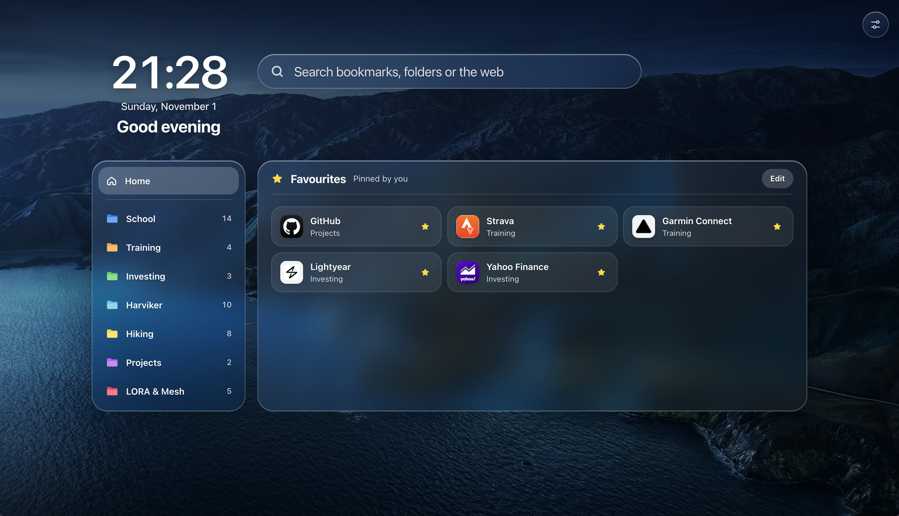

# Overlook

Overlook is a hobby project I made for myself, mostly with Claude Code. I wanted my browser's new tab page to look good and get me to my bookmarks fast, so I borrowed from macOS: a Spotlight-style search, frosted-glass panels and a wallpaper that follows the sun. Halfway through, I figured that since I was building it anyway, I might as well make it public. If it looks useful to you, give it a try.

It runs in Chrome, Edge, Brave and most other Chromium browsers.



## Features

- Bookmark folders in a sidebar, subfolders as sections
- Spotlight-style search: typo-tolerant, most-used first, web search as a fallback
- Home with pinned favourites and your most-used links
- Sharp site icons, cached for offline and VPN sites
- Labels by address, such as VPN
- Bundled photos, your own image or a [dynamic wallpaper](#dynamic-wallpaper-optional)
- Stays readable on bright backgrounds
- Keyboard-first

## Install

You need Chrome or Edge 137 or newer, or another browser built on Chromium 137 or newer, such as a current Brave or Vivaldi. Overlook doesn't work in Opera, which doesn't let extensions replace its new tab page.

1. Download `overlook-v<version>.zip` from the [Releases](../../releases) page and unzip it. Move the `overlook` folder inside it somewhere permanent: the browser runs the extension from there.
2. Open `chrome://extensions`, `edge://extensions` or `brave://extensions`.
3. Turn on **Developer mode**, click **Load unpacked** and choose the `overlook` folder.
4. Open a new tab. If the browser asks whether to keep the new tab page Overlook set, keep it.

To update, replace the contents of your `overlook` folder with the new release, keeping its `wallpapers` folder if you added one, and click the reload button on Overlook's card. Your settings, favourites and icons stay. Don't remove Overlook and load it again: **Remove** deletes everything it kept.

To build it yourself instead, install Node.js 24 or newer, run `npm ci` and `npm run build`, and load the `dist` folder.

## Using Overlook

Start typing anywhere to search. `↑` `↓` and `Enter` open a result, `Tab` searches inside a folder and `Esc` backs out. ☆ pins a bookmark to Home. Settings (top right, or `,`) has the background, Home, labels and icons. Shortcuts use `⌘` on a Mac and `Ctrl` elsewhere.

## Dynamic wallpaper (optional)

Bring a set of pictures of one scene and Overlook shows the one that matches the sun where you are, worked out from your time zone, never your location. Put them in a `wallpapers` folder inside `overlook` with a `manifest.json` like this one, then reload Overlook on the extensions page.

```json
{
  "version": 1,
  "frames": ["dawn.jpg", "noon.jpg", "dusk.jpg", "night.jpg"],
  "mode": "solar",
  "schedule": [
    { "frame": 3, "altitude": -20, "azimuth": 30 },
    { "frame": 0, "altitude": 2, "azimuth": 95 },
    { "frame": 1, "altitude": 55, "azimuth": 170 },
    { "frame": 1, "altitude": 55, "azimuth": 190 },
    { "frame": 2, "altitude": 2, "azimuth": 265 },
    { "frame": 3, "altitude": -20, "azimuth": 330 }
  ]
}
```

`frame` counts from 0. In `"solar"` mode each entry gives the sun's altitude and azimuth (0 to 360, east is 90) when its picture was taken. The azimuth only tells morning from evening, so a picture used for both needs two entries. In `"time"` mode, entries use `dayFraction` instead, from 0 (midnight) to 1. File names may use ASCII letters, digits, `_`, `-` and `.`, and end in `.jpg`, `.jpeg`, `.png`, `.webp` or `.avif`.

## Privacy and permissions

No servers, no analytics, no third-party code. Everything stays in your browser, and removing Overlook deletes it. Overlook only goes online to fetch your bookmarked sites' icons, without cookies, and the browser blocks its requests to private-network addresses unless you bookmarked that address yourself.

| Permission                            | Why                                          |
| ------------------------------------- | -------------------------------------------- |
| `bookmarks`                           | Show and search your bookmarks               |
| `declarativeNetRequestWithHostAccess` | Block requests to private-network addresses  |
| `favicon`                             | Small browser icon while a sharp one loads   |
| `search`                              | Web search with your default search engine   |
| `storage`                             | Settings, labels and most-used links         |
| `unlimitedStorage`                    | Keep icons and your image when disk runs low |
| `https://*/*` and `http://*/*`        | Download site icons; nothing is injected     |

## Troubleshooting

- **Icons are missing for VPN or intranet sites:** connect to the network, open Settings and press **Download icons again**.
- **An intranet site that forwards to another address has no icon, or a blurry one:** bookmark the address it lands on (say `nas.lan:5000` for `nas`) and use that bookmark, then press **Download icons again**.
- **A new tab still shows the browser's own page:** check that Overlook is turned on and that you kept its new tab page when the browser asked. In Vivaldi, set **Settings → Tabs → New Tab Page** to **Controlled by Extension**. Work or school browsers may block extensions loaded in developer mode.
- **A `file://` bookmark doesn't open:** open Overlook's **Details** on the extensions page and turn on **Allow access to file URLs**.
- **The address bar flashes when a new tab opens:** that's Overlook moving the cursor into its search. Turn it off under Home in Settings.
- **To uninstall:** click **Remove** on Overlook's card, then delete the `overlook` folder.

## Credits and licences

Overlook is under the [MIT License](LICENSE), except for the bundled photos. They come from Unsplash and are used under the [Unsplash License](https://unsplash.com/license): [Autumn forest](https://unsplash.com/photos/qG-zuuHbFTw) by Kush Dwivedi, [Still lake](https://unsplash.com/photos/R9-Hwv8nDl0) by Ahmet Yüksek, [Golden haze](https://unsplash.com/photos/wndpWTiDuT0) by Cristina Gottardi and [Alpine ridge](https://unsplash.com/photos/HXbAioPEVyQ) by Dario Jud. Time zone locations come from the [IANA tz database](https://www.iana.org/time-zones).

To report a security issue, see [SECURITY.md](.github/SECURITY.md).
